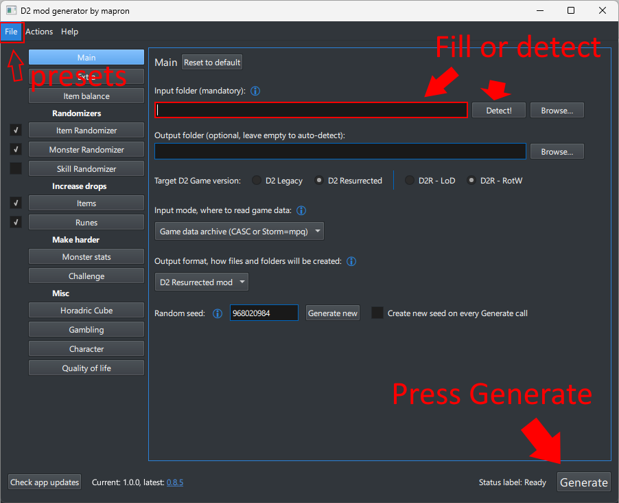
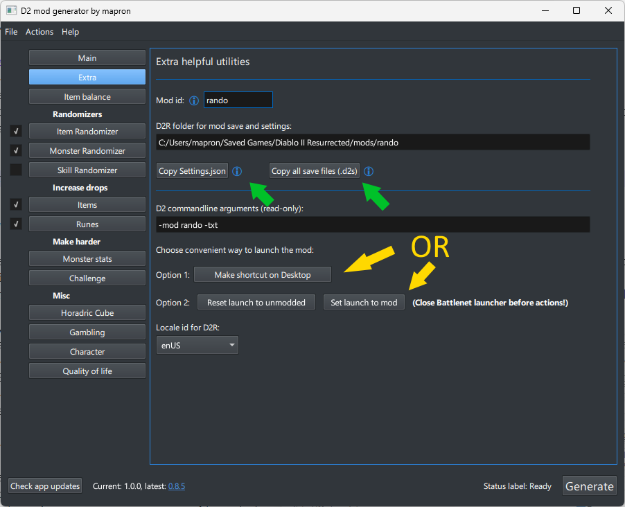
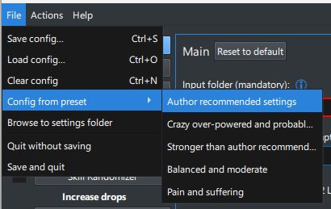

# Diablo 2 mod generator

Generator is inspired by [d2modmaker](https://github.com/tlentz/d2modmaker). It provides fast and easy way to create mod without any modding knowledge.  
Features included:  
- GUI-based desktop application with "one click and go" solution;
- Item randomizer - create new properties for Uniques, Runewords, Sets, Magic/Rare and even gems and runes!
- Monster randomizer - now any zone can have any monster! (balance taken into account);
- Increase monster density and boss pack count to insane numbers;
- Tired of finding High Runes? Bring drop levels to crazy amounts, adjust uniques, Runes and more;
- Ability to adjust monster stats;
- Make you life easier with dozens of quality-of-life features;  
  
  
See screenshots below to have a look what d2modgen supports - and you can get comprehensive help on each page by clicking help icon.  
If you interested in history of changes, [changelog is here](Changelog.md)

# Quick start
  
Main Window  
1. Download zip archive from [releases page](https://github.com/mapron/d2modgen/releases);
2. Extract wherever you want and go inside extracted folder;
3. Run modgen.exe in root folder; (see the screenshot);
4. Check if "Input folder" is filled correctly; if not, edit it manually to point "Diablo II Resurrected/" folder;
5. Select "File" => "Config from preset" => "Author recommended settings";
6. Press "Generate" button.

Now randomizer mod is created, see next chapter how to set launch for D2R.

# Set launch for mod in D2R
  
Go to "Extra" Tab
1. Optional; press "Copy Settings.json" to initialize new mod with your default game settings (music volume, etc);
2. Optional; press "Copy all save files" to copy character files to randomizer mod;
3. Now you need to setup modded launch of D2R - that can be done either by creating the shortcut or modifying launch option in BNet launcher, choose what is suitable for you:  
a) Press "Make shortcut on Desktop", that will make "Diablo II - modname Mod" link on your Desktop;  
b) OR copy value from "D2R command arguments" and create shortcut by yourself, pointing to D2R.exe and use this as extra args;  
c) OR close Battlenet client, press "Set launch to mod" to setup game launch as modded by default and launch BNet again;  
d) OR make it manually, by going  "Settings near Play button" - "Game Settings" - "Diablo II Resurrected" - "Additional command line arguments" and paste string from "D2R commandline"  
4. Launch the game and go to offline tab mode. Create a new character and start;

If you done everything correct, new character will have Horadric Cube in the inventory after creation.  

Now, go and play around with other settings, click "Generate" and restart D2R again!  
Note 1: all you offline character still exist in non-modded save folder.  
Note 2: mod does not affect online play in any way, you won't get banned for it.  
Note 3: if you want to return to unmodded, press "Reset launch to unmodded" (again, BNet must be closed when you press this button).

# Start new config from preset
  
There are 5 pre-made configs to quickly start rando!  
For starters I recommend first in the list.

# Detailed docs with screenshots
**[Check documentation and in-game screenshots here](docs/app.md)**

# How to build from the source
Prerequisites:
1. **Qt 6.12**
2. **CMake 4.0** 
3. **C++23 compiler**. Tested: MSVC 2026  

If requirements are met, then go "cmake/build/build install". For windows platform, "build install" creates install in binary directory with all runtime dependencies.

# Contribute
1. follow clang-format rules in `src/` directory;
2. Generator logic is in `src/CoreLib/Modules/`;
3. Corresponding ui configs are in `qml/Modules/Module-Something-.qml`

# Used thirdparty products
- (MIT) CascLib (https://github.com/ladislav-zezula/CascLib) is used for Blizzard CASC data storage read;
- (Zlib) Zlib library is used internally by CascLib;
- (MIT) StormLib (https://github.com/ladislav-zezula/StormLib) is used for reading MPQ files.

# Third party components as non-distributed dependency
- Qt , https://www.qt.io/, GPL/LGPL/Commercial; components utilized by d2modgen are available under LGPL.

# License
Project source code is licensed under [BSL-1.0 license](LICENSE) - copyleft, permissive, no attribution is required in binaries.
